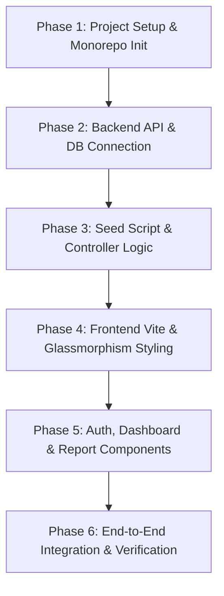

# Full-Stack Web Application Implementation Plan

## 1. Project Overview & Architecture
This implementation plan specifies the complete end-to-end architecture for a modern, enterprise-grade full-stack web application with a glassmorphism aesthetic (supporting both dark and light modes).

### Target Technology Stack
- **Frontend**: React (Vite bundler), Vanilla CSS Design System with CSS variables and glassmorphism tokens, Lucide React icons.
- **Backend**: Node.js, Express.js REST API with modular controllers, routes, and error handling.
- **Database & ORM**: **MongoDB with Mongoose** (selected for instant, zero-migration schema setup, flexible document modeling, and native JSON handling; verified running locally on port 27017).
- **Authentication**: JWT (JSON Web Tokens) with bcrypt password hashing and Bearer token headers.
- **Project Structure**: Clean monorepo with dedicated `frontend/` and `backend/` directories, orchestrated from root.

---

## 2. Monorepo Directory Structure

```
pulse-app/
├── package.json                     # Root orchestrator scripts (concurrent dev)
├── implementation_plan.md           # Architecture blueprint
├── backend/
│   ├── config/
│   │   └── db.js                    # Mongoose database connection
│   ├── controllers/
│   │   ├── authController.js        # Register, login, profile validation
│   │   ├── dashboardController.js   # KPI aggregation & chart time-series
│   │   └── reportController.js      # CRUD operations, filtering, export
│   ├── middleware/
│   │   ├── authMiddleware.js        # JWT verification & role authorization
│   │   └── errorHandler.js          # Centralized error response formatter
│   ├── models/
│   │   ├── User.js                  # User schema & password hashing hook
│   │   ├── Report.js                # Report schema with status & metrics
│   │   └── Activity.js              # Audit log / recent activity feed
│   ├── routes/
│   │   ├── authRoutes.js            # /api/auth
│   │   ├── dashboardRoutes.js       # /api/dashboard
│   │   └── reportRoutes.js          # /api/reports
│   ├── seed/
│   │   └── seedData.js              # Mock data generator for instant demo
│   ├── .env.example
│   ├── package.json
│   └── server.js                    # Express app entry & middleware pipeline
└── frontend/
    ├── public/
    │   └── favicon.svg
    ├── src/
    │   ├── assets/
    │   ├── components/
    │   │   ├── common/
    │   │   │   ├── GlassCard.jsx    # Reusable glassmorphic frosted card
    │   │   │   ├── Navbar.jsx       # Floating glass topbar & profile menu
    │   │   │   ├── Sidebar.jsx      # Navigation sidebar with collapse
    │   │   │   ├── ThemeToggle.jsx  # Dark/Light mode toggle switch
    │   │   │   ├── Modal.jsx        # Glass modal dialog for report creation
    │   │   │   └── Toast.jsx        # Floating notifications
    │   │   ├── auth/
    │   │   │   ├── LoginForm.jsx    # Glassmorphic login box
    │   │   │   └── RegisterForm.jsx # Registration with role selection
    │   │   ├── dashboard/
    │   │   │   ├── StatCard.jsx     # Metric cards with glow & trend indicators
    │   │   │   ├── MetricChart.jsx  # Interactive SVG-based data chart
    │   │   │   ├── ActivityFeed.jsx # Live audit / event timeline
    │   │   │   └── QuickActions.jsx # One-click report and filter triggers
    │   │   └── reports/
    │   │       ├── ReportTable.jsx  # Sortable, paginated data grid
    │   │       ├── ReportFilters.jsx# Category, status, and search filters
    │   │       └── CreateReportModal.jsx # New report form with live preview
    │   ├── context/
    │   │   ├── AuthContext.jsx      # Global auth state & token persistence
    │   │   └── ThemeContext.jsx     # Dark / light glassmorphism state
    │   ├── services/
    │   │   └── api.js               # Axios / Fetch client with auth interceptor
    │   ├── App.css                  # Layout, grid, and animations
    │   ├── App.jsx                  # Main view router & shell
    │   ├── index.css                # Glass tokens, typography, CSS resets
    │   └── main.jsx                 # React root mount
    ├── index.html
    ├── package.json
    └── vite.config.js
```

---

## 3. Database Schema (Mongoose Models)

### A. User Schema (`backend/models/User.js`)
| Field | Type | Attributes | Description |
|---|---|---|---|
| `name` | String | Required, Trimmed | Full name of user |
| `email` | String | Required, Unique, Lowercase | Login credential |
| `password` | String | Required, Min length: 6 | Bcrypt hashed string |
| `role` | String | Enum: `['Admin', 'Manager', 'Analyst']`, Default: `'Analyst'` | RBAC permission level |
| `avatar` | String | Optional | URL or placeholder avatar |
| `createdAt` | Date | Default: `Date.now` | Account creation timestamp |

### B. Report Schema (`backend/models/Report.js`)
| Field | Type | Attributes | Description |
|---|---|---|---|
| `title` | String | Required | Name of the generated report |
| `category` | String | Enum: `['Financial', 'Operational', 'Marketing', 'System']` | Classification bucket |
| `status` | String | Enum: `['Completed', 'Processing', 'Draft', 'Archived']`, Default: `'Completed'` | Lifecycle status |
| `summary` | String | Optional | Executive abstract |
| `metrics` | Object | Arbitrary Key-Value / JSON | Dynamic KPI metrics (revenue, conversions, etc.) |
| `generatedBy` | ObjectId | Ref: `'User'` | Author reference |
| `tags` | [String] | Array | Search tags |
| `downloads` | Number | Default: `0` | Export counter |
| `createdAt` | Date | Default: `Date.now` | Creation timestamp |

### C. Activity / KPI Schema (`backend/models/Activity.js`)
| Field | Type | Attributes | Description |
|---|---|---|---|
| `user` | ObjectId | Ref: `'User'` | Actor |
| `action` | String | Required | E.g. `"Created Report"`, `"Logged In"` |
| `details` | String | Optional | Contextual metadata |
| `type` | String | Enum: `['info', 'success', 'warning', 'danger']` | Visual badge indicator |
| `timestamp` | Date | Default: `Date.now` | Event time |

---

## 4. RESTful API Specification

### Authentication Endpoints (`/api/auth`)
- `POST /api/auth/register`  
  - **Body**: `{ name, email, password, role }`  
  - **Returns**: `{ token, user: { id, name, email, role } }`
- `POST /api/auth/login`  
  - **Body**: `{ email, password }`  
  - **Returns**: `{ token, user: { id, name, email, role } }`
- `GET /api/auth/me`  
  - **Headers**: `Authorization: Bearer <token>`  
  - **Returns**: Current authenticated user profile

### Dashboard Endpoints (`/api/dashboard`)
- `GET /api/dashboard/stats`  
  - **Headers**: `Authorization: Bearer <token>`  
  - **Returns**: Aggregated KPIs (Total Reports, Active Analysts, System Health, Monthly Performance % change)
- `GET /api/dashboard/charts`  
  - **Query**: `?timeframe=7d|30d|90d`  
  - **Returns**: Formatted multi-series data points for dynamic chart rendering
- `GET /api/dashboard/activity`  
  - **Returns**: Top 10 most recent chronological activity records

### Reports Endpoints (`/api/reports`)
- `GET /api/reports`  
  - **Query**: `?category=&status=&search=&page=&limit=`  
  - **Returns**: `{ reports: [...], total, page, totalPages }`
- `POST /api/reports`  
  - **Body**: `{ title, category, summary, metrics, tags }`  
  - **Returns**: Newly created report record
- `GET /api/reports/:id`  
  - **Returns**: Full report details including metrics breakdown
- `PUT /api/reports/:id`  
  - **Body**: Partial updates (`status`, `title`, etc.)
- `DELETE /api/reports/:id`  
  - **Returns**: `{ success: true, message: "Report deleted" }`
- `GET /api/reports/:id/export`  
  - **Query**: `?format=json|csv`  
  - **Returns**: Downloadable export payload

---

## 5. UI/UX Design System & Glassmorphism Aesthetic

### Design Principles
1. **Glassmorphism Spec**:
   - `backdrop-filter: blur(16px) saturate(180%)`
   - Translucent background panels: `rgba(255, 255, 255, 0.05)` (dark) / `rgba(255, 255, 255, 0.65)` (light)
   - Subtle outer borders: `1px solid rgba(255, 255, 255, 0.12)` (dark) / `1px solid rgba(0, 0, 0, 0.06)` (light)
   - Diffuse colored ambient glows: Neon cyan/violet radial gradient backdrops that shimmer beneath the glass cards.
2. **Typography**:
   - Modern Google Font (`Inter` or `Plus Jakarta Sans`) with clear visual hierarchy, crisp letter-spacing, and subtle muted subtitles.
3. **Responsive Layout**:
   - Sidebar navigation automatically converts into a mobile drawer or bottom bar on compact screens.
   - Fluid CSS Grid and Flexbox layouts accommodating everything from mobile viewports to ultra-wide displays.
4. **Motion & Feedback**:
   - Subtle hover lift on glass cards (`transform: translateY(-3px)` + amplified specular glow).
   - Smooth theme transition curves without abrupt color flashes.

---

## 6. Implementation Stages & Verification Plan



1. **Phase 1**: Initialize monorepo directory at `C:\Users\yash pawar\.gemini\antigravity-ide\scratch\pulse-dashboard`, setup `backend/` and `frontend/` package configurations.
2. **Phase 2**: Implement Express server with MongoDB connection (`mongoose`), CORS, error middleware, and environment configurations.
3. **Phase 3**: Implement User, Report, and Activity models; build auth, dashboard, and report controllers; execute seed script for instant live testing.
4. **Phase 4**: Setup Vite React app with custom `index.css` glassmorphism tokens, CSS variables, and Lucide icons.
5. **Phase 5**: Build modular components:
   - Floating Navbar with Theme Toggle
   - Collapsible Glass Sidebar
   - Auth pages (Login/Register with JWT storage)
   - Dashboard (Interactive KPI cards, dynamic charts, live feed)
   - Reports (Searchable filter bar, status badges, creation modal, export trigger)
6. **Phase 6**: Test end-to-end API communication, verify dark/light mode toggle fidelity, responsiveness, and performance.
